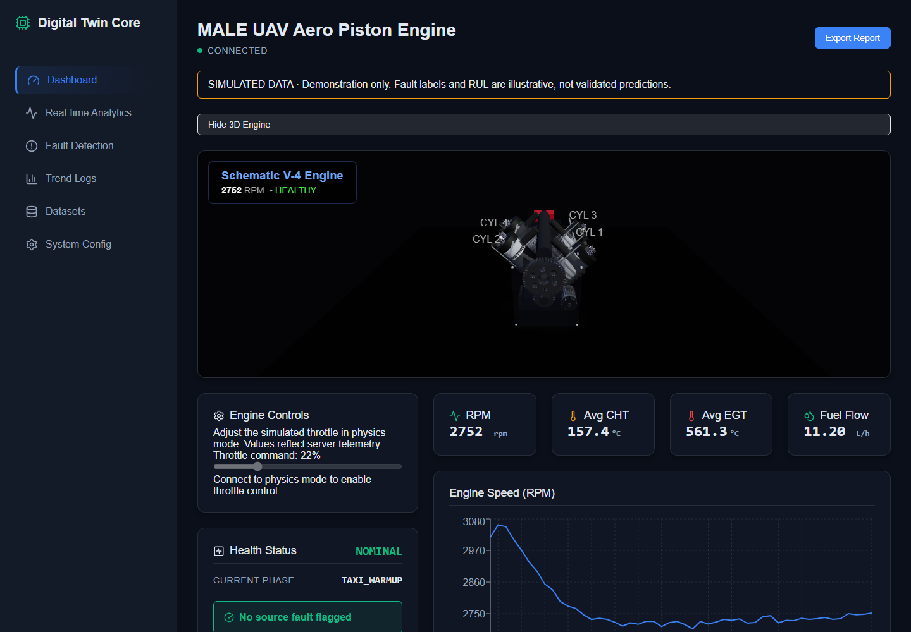

# SIH 2026 — Digital Twin Core

A local, interactive **simulated UAV engine dashboard**: control an illustrative engine model, replay three CSV datasets, inspect source fault labels and charts, and explore a schematic V-4 engine.

**Prototype, not aircraft software.** All included data is marked `SIMULATED`. There is no MAVLink/CAN connection, trained AI fault detector, calibrated engine model, or validated remaining-life prediction. The RUL counter and subsystem scores illustrate UI behavior, not maintenance decisions.



## Try it locally

Use Node.js **24.x** (`.nvmrc`), npm, Python **3.14**, and a WebGL-capable browser. Python 3.14 is the tested/CI target; older versions are not part of this validation.

```bash
git clone https://github.com/mukilbarath/SIH_2026.git
cd SIH_2026
npm ci --ignore-scripts
python -m venv .venv
```

Install/start the telemetry server in terminal one:

```powershell
# Windows PowerShell — no activation required
.venv/Scripts/python -m pip install -r server/requirements.txt
.venv/Scripts/python server/mavlink_sitl.py
```

```bash
# macOS / Linux
.venv/bin/python -m pip install -r server/requirements.txt
.venv/bin/python server/mavlink_sitl.py
```

Terminal two:

```bash
npm run dev
```

Open [http://127.0.0.1:3000](http://127.0.0.1:3000). Wait for **Connected**, then adjust throttle. The schematic 3D engine appears directly on the Dashboard in a WebGL-capable browser. The server filename is retained for compatibility; it speaks JSON WebSocket, not MAVLink.

## What to explore

- **Dashboard:** engine schematic, throttle, temperatures, RPM and illustrative degradation.
- **Datasets:** physics, healthy, faults and scenarios. Every replay begins at its first row; fault datasets also contain healthy periods.
- **Fault Detection:** source labels/severity and hand-written illustrative subsystem scores.
- **Real-time Analytics:** fuel-flow/RPM ratio and temperatures. The ratio is **not BSFC**; torque/power is not measured.
- **Trend Logs:** latest 50 samples and working CSV export. Export Report downloads the same window as JSON with a simulation notice.
- **System Config:** actual endpoint and limitations. Configuration comes from environment variables; no pretend save operation.

Replays advance one row per 100 ms target tick, regardless of CSV timestamp spacing. All clients share one engine; the latest accepted control wins. Mode changes, source-run changes, replay wraps and reconnects reset chart history. See [protocol and architecture](docs/ARCHITECTURE.md).

## Configuration

Defaults work without configuration. Copy `.env.example` to `.env.local` to change `NEXT_PUBLIC_TELEMETRY_URL`; restart development or rebuild production after changing it. This value is public and embedded in the browser bundle.

The Python process reads **shell environment variables**, not `.env.local`:

| Variable | Default | Purpose |
| --- | --- | --- |
| `TELEMETRY_HOST` | `127.0.0.1` | Loopback only; nonlocal binding is rejected |
| `TELEMETRY_PORT` | `3002` | WebSocket port |
| `TELEMETRY_ORIGINS` | `http://localhost:3000,http://127.0.0.1:3000` | Exact allowed browser origins |

If you change the dashboard port, update the allowed origin explicitly. No authentication or TLS deployment is supplied. Keep this demonstration local; public hosting requires a separately reviewed authenticated transport design.

## Verify and build

Use your environment's Python executable (or activate `.venv`) for the Python commands:

```bash
npm run lint
npm run typecheck
npm test
python -m unittest discover -s tests -p 'test_*.py' -v
python scripts/validate_datasets.py --check
npm audit --omit=dev --audit-level=high
npm run build
npx playwright install chromium
npm run test:e2e
```

Browser tests start production Next.js and the simulator themselves. Stop manually started servers first; ports 3000/3002 must be free. Set `PYTHON` to the virtual-environment executable if not activated. On Windows: `$env:PYTHON = (Resolve-Path .venv/Scripts/python.exe).Path`. Run `npm run start` plus the Python server for a manual production demo.

CI runs the same checks. [Validation evidence](docs/VALIDATION.md) distinguishes software tests from scientific validation. [Improvement checklist](docs/IMPROVEMENTS.md) records completed work and genuine follow-ups.

## Structure

```text
app/                  Dashboard composition and responsive styles
components/           Typed charts, controls and schematic visualization
hooks/useTelemetry.ts Connection lifecycle and stale-data handling
lib/telemetry.ts      Runtime contract, history boundaries and safe CSV export
server/engine.py      Deterministic simulation and validated replay
server/mavlink_sitl.py Local WebSocket transport / compatibility entry point
server/telemetryStreamer.js Optional independent legacy Socket.IO replay
scripts/              Reproducible dataset inventory
tests/               Unit, real-socket integration and browser checks
docs/                 Architecture, provenance, validation and demo guide
```

The optional `node server/telemetryStreamer.js` remains available on loopback port 3001 for legacy Socket.IO clients. It is not used by the dashboard. Supply an allowed Origin header; see [architecture](docs/ARCHITECTURE.md).

## Troubleshooting

- **Disconnected:** start the Python server; verify URL/ports and origin allowlist. Automatic retries back off to 10 seconds. Stale telemetry is cleared after about three seconds.
- **Dataset startup failure:** read the filename/line error. Files are located relative to the source, so working directory does not affect replay.
- **3D unavailable:** enable WebGL/hardware acceleration. The view has a fallback; charts and controls remain usable. No external fonts are required.
- **No immediate fault:** replay includes healthy rows. Use the [demo guide](docs/DEMO.md) to explain labels accurately.

## Project notes

[Dataset provenance](docs/DATASETS.md) · [Security](SECURITY.md) · [Contributing](CONTRIBUTING.md) · [MIT license](LICENSE)

Original dataset generator, calibration records and independent dataset licensing evidence are not in this repository. No real-engine validation or performance benchmark is claimed.
