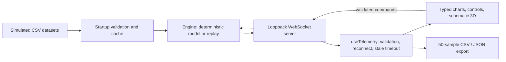

# Architecture and telemetry contract



## Module boundaries

`server/engine.py` has no network dependency. `Engine.command` validates an entire control before mutation. `Engine.step(0.1)` advances a deterministic 100 ms simulation tick. `load_dataset` validates every numeric cell and required field before the server begins accepting connections. No file reads occur in the telemetry loop.

`server/mavlink_sitl.py` owns transport limits and one Engine shared by all clients. The historical filename remains a compatibility entry point only. Each tick sends to a snapshot of clients concurrently, with a send deadline; a failed producer stops the server instead of leaving a silent orphan task. The cadence targets 10 Hz, not a hard real-time guarantee. Simulation time advances by 0.1 per tick even if host load delays delivery.

`hooks/useTelemetry.ts` owns the browser socket, cleanup, capped retry delay and three-second stale timeout. `lib/telemetry.ts` validates received data before rendering and bounds history at 50 samples. Stale/disconnected state clears current readings and disables controls. Chart windows restart on mode/run changes, source-time wrap or sequence restart. `app/page.tsx` composes views; the expensive 3D view loads separately and has an error boundary.

## Protocol v1

Text JSON over WebSocket, default `ws://127.0.0.1:3002`. The browser must present an allowed Origin. Native clients must explicitly send one too. No credentials or aircraft-control protocol are involved.

Commands have exactly two keys:

```json
{"type":"set_throttle","value":50}
{"type":"set_mode","value":"faults"}
```

Throttle is a JSON number in [0,100], finite, allowed only in physics mode. Modes: `physics`, `healthy`, `faults`, `scenarios`. Strings, booleans, nulls, unknown modes/commands and extra keys are rejected without state mutation. Re-selecting a mode restarts that mode. A valid command yields `{"type":"ack","command":"set_mode","value":"faults"}`; rejected input yields `{"type":"error","message":"Invalid command or unavailable control"}`. An acknowledgement means accepted, not persisted.

[Example complete payload](../tests/fixtures/telemetry.json) is generated by the model. Required fields:

| Fields | Meaning / units |
| --- | --- |
| `type`, `schema_version` | `telemetry`, `1` |
| `sequence`, `time_s` | Process-wide sequence and elapsed simulation seconds |
| `mode`, `provenance` | Active mode; always `SIMULATED` |
| `source_time_s`, `run_id`, `phase` | Original replay metadata; null/null/THROTTLE_DEMO in physics |
| `throttle_pct`, `rpm` | Percent, revolutions/minute |
| `fuel_flow_lph` | Litres/hour |
| `cht_1_c`…`cht_4_c`, `egt_1_c`…`egt_4_c`, `oil_temp_c` | Degrees Celsius |
| `oil_pressure_bar` | Bar |
| `vibration_x_g`, `vibration_y_g`, `vibration_z_g` | g |
| `fault_label`, `fault_severity` | Source label and illustrative severity [0,1]; not model inference |
| `rul_hours` | Illustrative counter in hours; not CSV ground truth or a life forecast |

## Model and replay semantics

Physics retains the original throttle-to-RPM target (50 × throttle), 5% running threshold, temperature targets and illustrative fuel-flow formula. RPM and temperatures use stable exponential first-order response. The sinusoidal perturbations use simulation time, so identical commands and steps reproduce results. There is no random sensor calibration or Gaussian noise claim.

The illustrative life counter starts at 500; physics decrements only while running, 10× above 4500 RPM. Replay decrements at `dt/3600 × max(1,(rpm/3000)^2) × (1+severity×500)`. It clamps at zero and resets on mode selection, source-run boundaries and replay wrap. Those constants are UI demonstration choices, not empirical coefficients. Physics mode changes reset RPM/temperatures while retaining the last physics throttle setting.

Replay preserves source order and loops. One row is emitted per tick; source timestamps are retained separately and do not determine pacing. CSV `rul_hours` is not used by the counter. Fault status is consistent across views: healthy requires label HEALTHY **and** zero severity. The radar is a label-based illustration; no Isolation Forest or Autoencoder exists here.

## Security boundary and legacy path

Loopback-only binding, exact Origin allowlist, 1 KiB incoming message limit, queue limit 8, 16-client limit, and 30 commands/second/client. Browser throttle input is coalesced. Controls are deliberately shared, unauthenticated and not persistent. Origin filtering protects browsers but is not authentication; a native local program can forge an Origin. Do not expose ports through a public proxy/tunnel.

The optional Socket.IO server on 127.0.0.1:3001 caches datasets at startup. It emits raw CSV `telemetry` events; `set_scenario` accepts only healthy/faults/scenarios, emits `scenario_changed`, rejects unknown values, and limits mode-switch frequency. It uses a different protocol and is not a drop-in replacement for the Python server.

API options were checked against the [websockets server documentation](https://websockets.readthedocs.io/en/stable/reference/asyncio/server.html). Network behavior is tested against the pinned installed release.
